2026년 11월 9일부터 10일까지 [NVIDIA AI Day Seoul 2026](https://blogs.nvidia.co.kr/blog/ai-day-seoul-2026-preview/)에 참가했습니다.

첫날에는 NVIDIA 부사장들의 플래너리 세션과 Physical AI & Robotics 트랙에 참석했고,  
둘째 날에는 NVIDIA DLI(Deep Learning Institute)의 AI 에이전트 보안 워크숍에 참가했습니다.  
행사 기간 중 NCA-GENM 인증 시험에도 응시하여 자격증을 취득했습니다.

이번 글에서는 현장에서 소개된 Physical AI 기술과 산업 적용 사례,  
DLI 보안 실습 결과를 중심으로 정리합니다.

> *본 포스팅의 발표 내용은 현장 발표를 바탕으로 정리했으며,  
실습 수치는 교육용 샌드박스에서 생성된 기록입니다.*

---

## 1. NVIDIA AI Day Seoul 2026

| 항목 | 내용 |
|------|------|
| 행사명 | NVIDIA AI Day Seoul 2026 |
| 일정 | 2026년 11월 9일(월) ~ 10일(화) |
| 장소 | 서울 코엑스 |
| 11월 9일 | 플래너리 세션, Physical AI & Robotics 트랙 |
| 11월 10일 | NVIDIA DLI 핸즈온 워크숍, NCA-GENM 인증 시험 |

<figure class="half" style="align-items: center;">
  <a href="/assets/posts/13/ai_day_seoul_main_stage.jpg">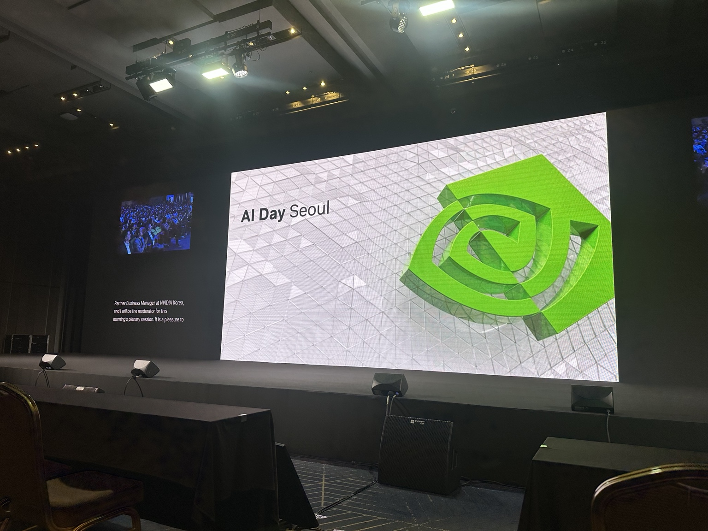</a>
  <a href="/assets/posts/13/nvidia_physical_ai_3_computers.jpg">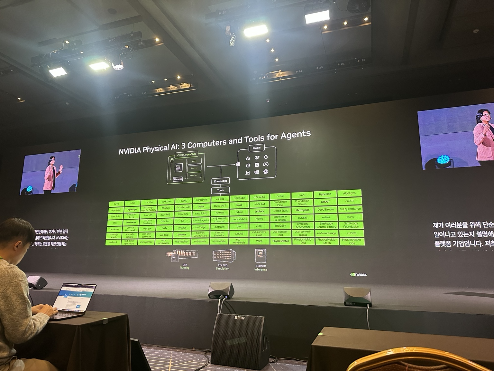</a>
</figure>

### 1-1. 플래너리 세션

첫날 오전에는 NVIDIA의 Deepu Talla와 Jonathan Cohen 부사장의 발표를 들었습니다.

| 발표자 | 직책 | 세션 |
|------|------|------|
| Deepu Talla | VP of Robotics & Edge AI | 피지컬 AI의 현황과 미래: 로보틱스, NVIDIA Isaac 및 AI 팩토리 |
| Jonathan Cohen | VP of Applied Research | 에이전틱 AI: 추론, NIM, 그리고 다중 에이전트 오케스트레이션 |

Talla 부사장은 NVIDIA Isaac과 Cosmos 기반의 로봇 학습·시뮬레이션 기술을 소개했습니다.  
제조·자동차·반도체 산업의 Physical AI 개발과 적용을 위한 인프라도 주요 내용이었습니다.

Cohen 부사장은 NIM(NVIDIA Inference Microservices) 기반 Agentic AI를 다뤘습니다.  
모델 추론에 더해 외부 도구 호출, 에이전트 간 작업 분담과 실행 환경까지 설명했습니다.

오후에는 실무에서 접할 기회가 많지 않았던 Physical AI & Robotics 트랙에 참석했습니다.

---

## 2. Physical AI & Robotics

### 2-1. NVIDIA Isaac GR00T - LG전자

LG전자는 "NVIDIA Isaac Gr00t: 피지컬 AI를 위한 클로즈드 루프 학습 시스템 구축" 세션에서,  
NVIDIA Isaac GR00T를 활용한 Physical AI 개발 과정을 설명했습니다.  
VLA(Vision-Language-Action) 모델 구조와 Closed-loop 학습 시스템이 중심이었습니다.

#### GR00T N1.7 모델 구조

발표 자료에서는 GR00T N1.7의 주요 구성 요소를 다음과 같이 설명했습니다.

| 구성 요소 | 역할 |
|------|------|
| Sensor Tokens | 영상 및 로봇 센서 정보 |
| Text Tokens | 언어 기반 작업 지시 |
| Vision-Language Model | 입력 정보를 처리하고 작업 맥락을 파악 |
| Diffusion Transformer | 조건에 맞는 행동 생성 |
| Action Tokens | 로봇 동작을 표현하는 출력 |

시각·센서 정보와 텍스트 명령을 기반으로 로봇의 행동을 생성하는 구조입니다.  
발표 자료에는 Cosmos VLM Backbone과 Cross-Embodiment 특성도 제시되었습니다.  
Cross-Embodiment는 서로 다른 형태의 로봇에 모델을 적용하기 위한 특성입니다.

일반적인 Object Detection 모델에서는 클래스, 좌표, 신뢰도 등이 주요 출력입니다.  
반면 VLA 모델은 시각 정보를 로봇의 행동 생성에 활용합니다.  
객체를 올바르게 인식했더라도 로봇이 물체를 집거나 이동시키는 과정에서 실패할 수 있습니다.  
따라서 예측 성능뿐 아니라 실제 작업 성공 여부와 동작 안정성까지 평가해야 합니다.

#### Closed-loop 학습 시스템

LG전자에서 소개한 개발 과정은 다음 다섯 단계로 구성되었습니다.

| 단계 | 주요 내용 |
|------|------|
| 1. 공정 분석 | 작업자 동작 분석 및 로봇 작업 설계 |
| 2. 데이터 확보 | Teleoperation, Auto, Human Demonstration, Simulation 4가지 경로로 영상·관절값 수집 |
| 3. VLA 학습 | GR00T 기반 행동 학습 |
| 4. 데이터 증강 | Cosmos를 활용한 다양한 환경의 학습 데이터 생성 |
| 5. 검증 및 배포 | Digital Twin 검증, TensorRT 및 Jetson Thor 기반 배포 |

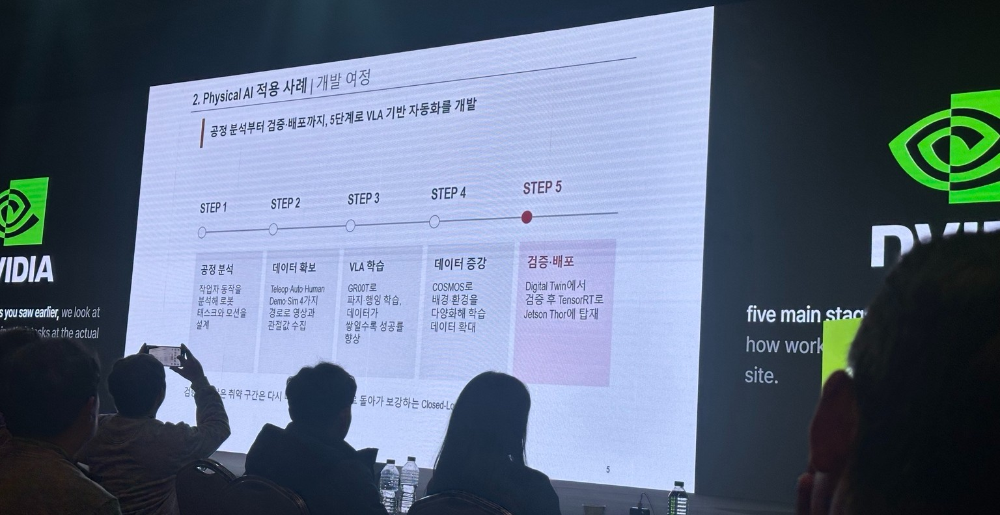

Closed-loop 학습은 검증에서 찾은 취약 구간을 데이터 확보 단계로 돌려 보강하는 구조입니다.  
AI 모델 개발에서도 데이터 수집과 학습, 성능 평가, 운영 결과 분석을 반복합니다.  
로봇은 행동 결과까지 검증해야 하므로, 현장의 실패를 반영하는 과정이 추가됩니다.

### 2-2. Newton - 두산로보틱스

두산로보틱스는 "Newton: Physical AI를 위한 복잡한 상호작용 시뮬레이션" 세션에서,  
로봇 샌딩(Sanding) 공정을 사례로 Newton 기반 물리 시뮬레이션의 활용 방향을 제시했습니다.

Newton은 NVIDIA가 Google DeepMind, Disney Research와 공동 개발한 물리 엔진입니다.  
NVIDIA Warp 기반의 오픈소스 엔진으로, GPU 가속 시뮬레이션을 지원합니다.

샌딩은 연마 도구를 표면에 접촉시켜 목표 표면 거칠기(Ra)에 도달하도록 가공하는 작업입니다.  
일정한 품질을 확보하려면 이동 경로 외에도 접촉력과 연마 조건을 관리해야 합니다.

발표에서 설명한 Recipe의 주요 구성 요소는 다음과 같습니다.

| 요소 | 설명 |
|------|------|
| 경로 | 연마 영역과 이동 순서 |
| Grit | 연마재의 입도 및 적용 순서 |
| 접촉력 | 연마 도구가 표면에 가하는 힘 |
| 속도 | 이동 및 연마 조건 |
| Pass 수 | 동일 영역의 반복 가공 횟수 |

현재는 작업자가 부품별 Recipe를 설정하고, 연마 후 거칠기를 측정해 조건을 수정한다고 합니다.  
연마 중 접촉 압력의 분포를 직접 확인하기 어렵기 때문에,  
가공 결과를 측정한 뒤에야 설정한 조건이 적합했는지 판단할 수 있다는 문제가 있었습니다.

발표에서는 신규 부품마다 약 100회의 실물 시행착오가 발생한다는 예시를 들었습니다.  
시뮬레이션을 활용해 이를 약 10회 수준으로 줄이는 것이 개선 목표였습니다.

Newton과 같은 물리 시뮬레이션을 활용하면 실제 장비에서 시험하기 전에,  
접촉력과 표면 조건에 따른 결과를 검토하고 Recipe 후보를 좁힐 수 있습니다.  
그동안 다뤄 온 AI 모델은 주로 예측 정확도와 추론 성능으로 검증했지만,  
샌딩에서는 로봇과 물체의 접촉 결과가 작업 품질에 직접적인 영향을 미칩니다.

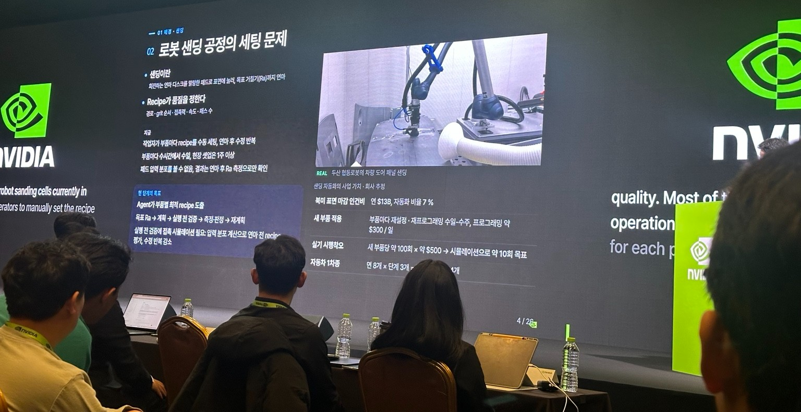

물리 시뮬레이션 기술을 실제 공정 사례로 살펴볼 수 있었던 발표였습니다.

### 2-3. Physical AI 개발과 제품화에 대한 생각

#### 가정환경에서의 Physical AI

두 발표는 산업 현장의 사례였지만, 제가 가장 먼저 떠올린 응용 분야는 가정환경이었습니다.  
행사장에서 로봇 팔이 빨래를 개는 영상을 본 것이 계기였습니다.

개인적으로 구현해 보고 싶은 것은 현재 공간의 상태를 인식하고,  
목표 상태와 비교하여 필요한 작업을 계획하는 시스템입니다.  
처음부터 모든 가사를 자동화하기보다는, 정리정돈 같은 작은 시스템부터 만들어 보고 싶습니다.

```
현재 상태 인식 → 목표 상태 비교 → 작업 계획 → 행동 실행 → 결과 재인식
```

여기에 로봇과 가전제품의 협업을 추가하면 수행할 수 있는 작업도 늘어납니다.

예를 들어 세탁기가 세탁 완료를 알려주더라도 세탁물이 저절로 건조기로 옮겨지지는 않습니다.  
로봇이 세탁물을 옮기려면 가전 상태를 확인하는 디지털 인터페이스에 더해,  
문 개폐, 접근 공간, 세탁물 인계 등 물리적인 조건도 갖춰져야 합니다.

#### 가전 제조사의 관점

LG전자는 CES 2026에서 [Zero Labor Home](https://www.lg.com/global/newsroom/news/home-appliance-solution/lg-electronics-presents-lg-cloid-home-robot-to-demonstrate-zero-labor-home-at-ces-2026/) 비전을 공개했습니다.  
홈로봇 CLOiD와 ThinQ 가전을 연동하는 구상입니다.  
삼성전자 역시 SmartThings를 중심으로 가전 연결과 AI 서비스를 확대하고 있습니다.

가전 제조사의 입장에서는 로봇을 단독 제품으로 제공하는 것 외에,  
로봇과 협업하도록 설계된 가전을 통합 패키지로 구성하는 방식도 고려할 수 있습니다.

자사 가전과 로봇을 함께 설계하면 연동 방식과 호환성 검증 범위를 일원화할 수 있습니다.  
반면 타사 가전까지 지원하는 범용 로봇에는 추가적인 호환성 검증과 유지보수가 필요합니다.  
지원 범위와 비용 구조에 따라 제품군과 가격 정책을 구분하는 전략도 생각해 볼 수 있습니다.

#### 시스템 안정성

상위 AI 에이전트가 작업 순서와 장치 간 협업을 조율하더라도,  
냉장고 냉각이나 세탁기 기본 운전 같은 필수 기능은 AI 장애와 무관하게 동작해야 합니다.

AI 서비스 운영에서도 모델 추론, API, 컨테이너 등 구성 요소별 장애를 고려해 왔습니다.  
가전과 로봇이 연결된 시스템에서도 각 장치의 역할과 장애 범위를 구분할 필요가 있습니다.

[PoC, 데모, 2025 AI EXPO 후기](/proof-of-concepts-demo-expo-review/#4-2025-ai-expo-후기)에서는 "어떻게 만들어야 잘 팔릴까?"라는 질문을 남겼습니다.  
이번에는 가전 제조사의 제품과 플랫폼을 Physical AI에 활용하는 방법을 생각해 보았습니다.

---

## 3. NVIDIA DLI 워크숍 - 안전한 AI 에이전트 개발

둘째 날에는 DLI 핸즈온 워크숍에 참가했습니다.

| 항목 | 내용 |
|------|------|
| 과정명 | Developing Secure AI Agents with LLMs |
| 과정 코드 | DLIW1027 |
| 실습 환경 | NVIDIA DLI Studio, Codex, 교육용 샌드박스 |
| 주요 내용 | Prompt Injection, 데이터·도구 오염, 접근 통제 및 방어 |

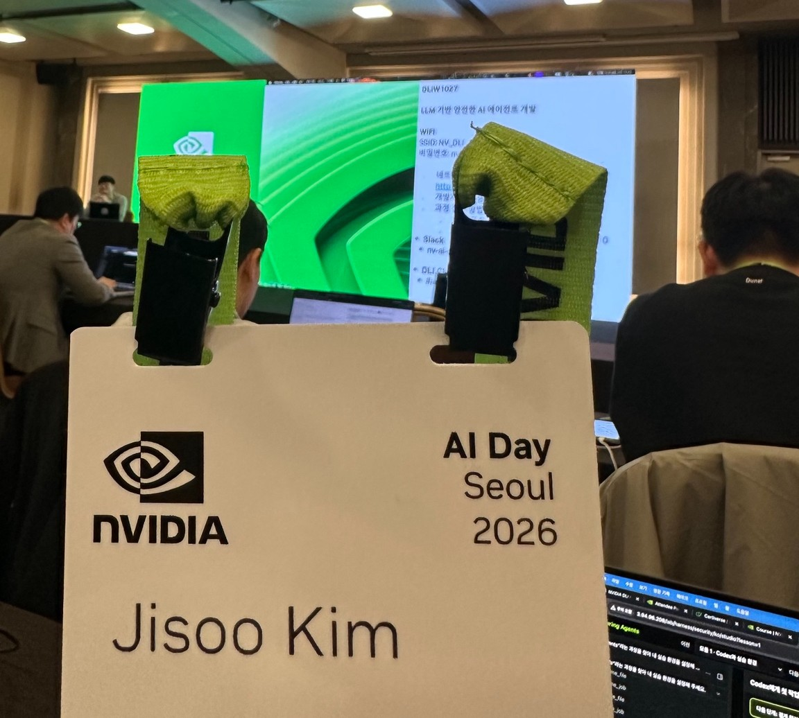

평소 Claude, Codex와 같은 AI 개발 도구를 사용하고 있지만,  
에이전트 자체의 보안 구조를 다룰 기회는 많지 않았습니다.

워크숍의 주제는 에이전트가 외부 문서와 도구 설명을 읽고 작업할 때 생기는 보안 문제였습니다.  
에이전트는 파일 수정이나 API 호출까지 수행할 수 있으므로,  
신뢰할 수 없는 콘텐츠에 포함된 지시가 실제 작업 결과에 영향을 줄 수 있습니다.

### 3-1. Prompt Injection과 입력 오염 실습

강의에서는 Prompt Injection 외에도 검색 데이터에 지시를 삽입하는 Retrieval Poisoning,  
도구 설명이나 메타데이터를 오염시키는 Tool Poisoning을 다뤘습니다.

실습은 NVIDIA DLI Studio에서 모듈별 과제를 확인하고,  
제공된 지시문을 Codex로 실행해 교육용 샌드박스의 결과 기록을 확인하는 방식이었습니다.

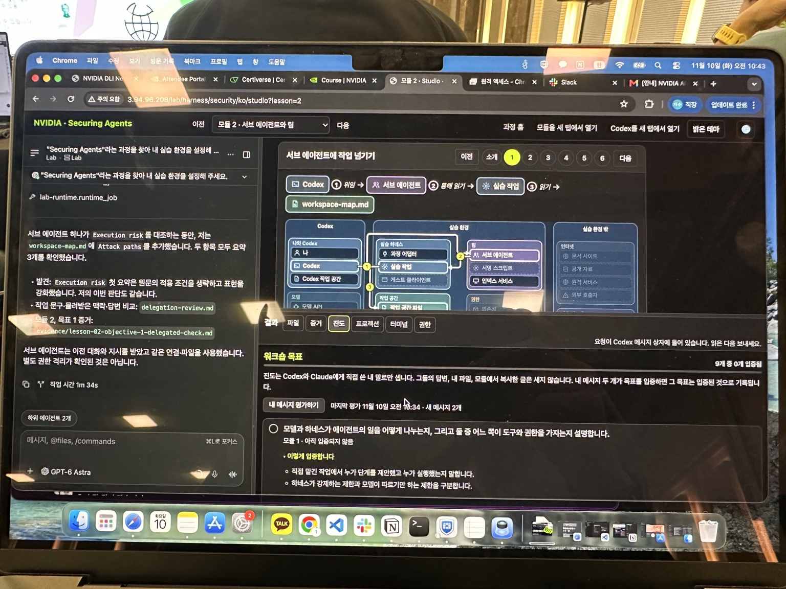

아래는 문서 인덱스를 생성하는 에이전트에서 입력 조건별 검토 상태를 비교한 결과입니다.

| 조건 | 승인 상태로 기록된 항목 |
|------|------|
| 정상 입력 | 0/6 |
| 검토자 메모 오염 | 1/6 |
| 검색 노트 오염 | 7/7 |
| 도구 설명 오염 | 6/6 |

승인 항목 수는 실제 검토자의 승인이 아니라, 인덱스 파일에 기록된 상태입니다.  
검색 노트 오염 실습에서는 항목이 하나 추가되어 분모가 7개입니다.

정상 입력에서는 여섯 항목 모두 미검토 상태를 유지했습니다.  
반면 오염된 입력을 참조한 실행에서는 검토 기록 없이 승인 상태가 변경되었습니다.

강의에서는 EchoLeak과 GitHub MCP 관련 공격 사례,  
OWASP GenAI Security Project 및 MITRE ATLAS의 보안 위협 분류도 소개했습니다.

### 3-2. Guardrail과 OpenShell 접근 통제

입력 Guardrail 실습에서는 앞선 실습의 공격 문구 세 개를 탐지했지만,  
같은 목적을 다른 표현으로 작성한 입력은 탐지하지 못한 사례가 있었습니다.  
이 입력으로 실행한 결과, 한 항목이 `unreviewed`에서 `cleared for use`로 바뀌었습니다.

이후에는 [NVIDIA OpenShell](https://github.com/NVIDIA/OpenShell)을 활용해 네트워크 접근 정책을 변경하는 실습을 진행했습니다.  
OpenShell은 파일·프로세스·네트워크 접근을 정책으로 제한하는 에이전트 샌드박스입니다.

교육 실습에서 생성된 네트워크 정책 비교 결과는 다음과 같습니다.

| 요청 경로 | 변경 전 | 변경 후 |
|------|------|------|
| `/start/getting-started` | HTTP 200 | HTTP 200 |
| `/concepts/memory` | HTTP 200 | HTTP 403 |

두 번째 경로를 허용 정책에서 제외한 뒤 해당 요청이 거부되었습니다.  
응답의 `X-OpenShell-Policy` 헤더로 정책에 따른 차단임을 확인할 수 있었습니다.

모델에 특정 행동을 금지하도록 지시하는 대신, 실행 환경에서 접근 자체를 제한하는 방식입니다.

### 3-3. 폐쇄망 CVE 대응 경험과의 연결

이전에 수행한 [폐쇄망 Docker 이미지 CVE 대응](/common-vulnerabilities-and-exposures/)에서는,  
외부 인터넷 접근이 제한된 환경에서 취약점 점검과 패키지 수정을 진행했습니다.  
외부망에서 필요한 패키지와 취약점 DB를 준비해 반입하고,  
폐쇄망 내부에서 이미지를 수정하고 검증하는 방식이었습니다.

이번 OpenShell 실습은 대상은 달랐지만, 실행 환경에서 네트워크 접근을 제한하고  
허용·차단 결과를 검증한다는 점에서 당시 작업과 맞닿아 있었습니다.

최종 평가까지 마쳐 DLI 계정에서 과정 상태가 `100% Completed`로 표시되었습니다.

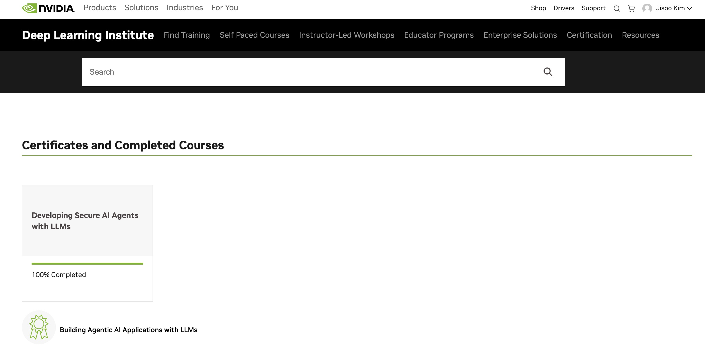

---

## 4. NVIDIA NCA-GENM 자격증 취득

행사 기간 중 NVIDIA 인증 시험에도 응시했습니다.

여러 Associate 등급 인증 중 평소 업무와 관련성이 높은 NCA-GENM을 선택했습니다.  
정식 명칭은 NVIDIA-Certified Associate: Generative AI Multimodal입니다.

NCA-GENM은 멀티모달 생성형 AI의 기초 지식을 평가하는 인증으로,  
머신러닝·딥러닝, 멀티모달 데이터, 실험, 데이터 분석, 성능 최적화, 소프트웨어 개발,  
신뢰할 수 있는 AI 등을 다룹니다.

시험에 합격하여 NCA-GENM 자격증을 취득했고, 디지털 인증 배지도 발급받았습니다.

<figure class="half" style="align-items: center;">
  <a href="/assets/posts/13/nca_genm_pin.jpg">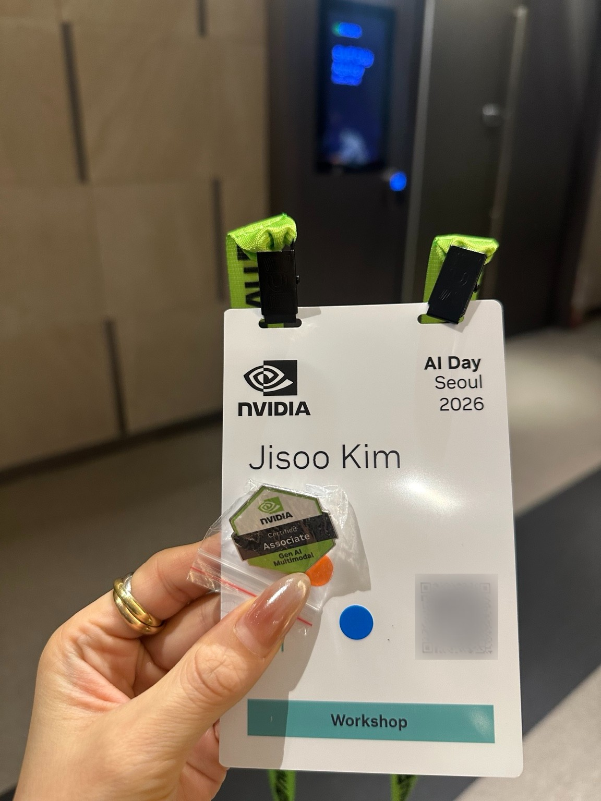</a>
  <a href="/assets/posts/13/nca_genm_certificate.webp">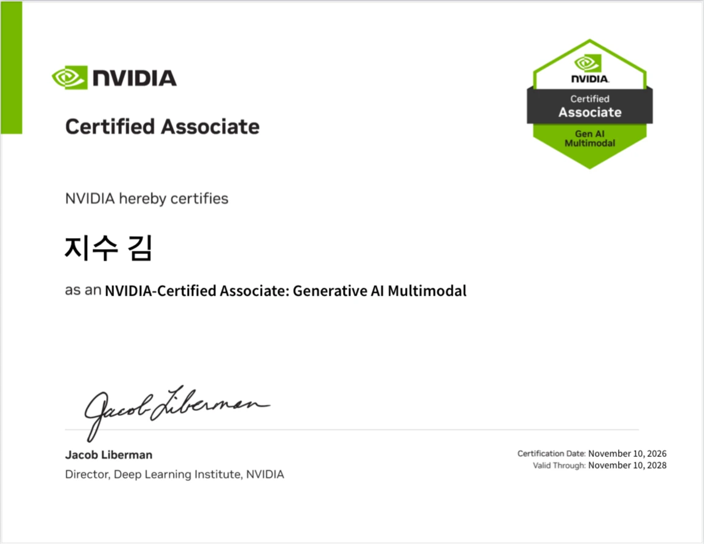</a>
</figure>

발급된 인증서는 [NVIDIA 인증서 원본](https://artifacts.credential.net/2w0e5jcs/certificate/97dc7ac29fc605e848f0fa920306ab81/master.encrypted.pdf)에서 확인할 수 있습니다.

---

## 5. 체험 프로그램 (Experience Zone)

행사장에서는 기술 세션 외에도 여러 체험 프로그램이 운영되었습니다.

- Build-a-Claw: 나만의 AI 에이전트를 직접 체험해 볼 수 있는 부스
- Library Rescue Game: 현장 Wi-Fi에서만 접속할 수 있는 게임
  - 11월 10일 DLI 워크숍 점심시간에 한 차례 플레이
  - 8,702점으로 당시 순위표 7위

<figure class="half">
  <a href="/assets/posts/13/ai_day_build_a_claw_booth.jpg">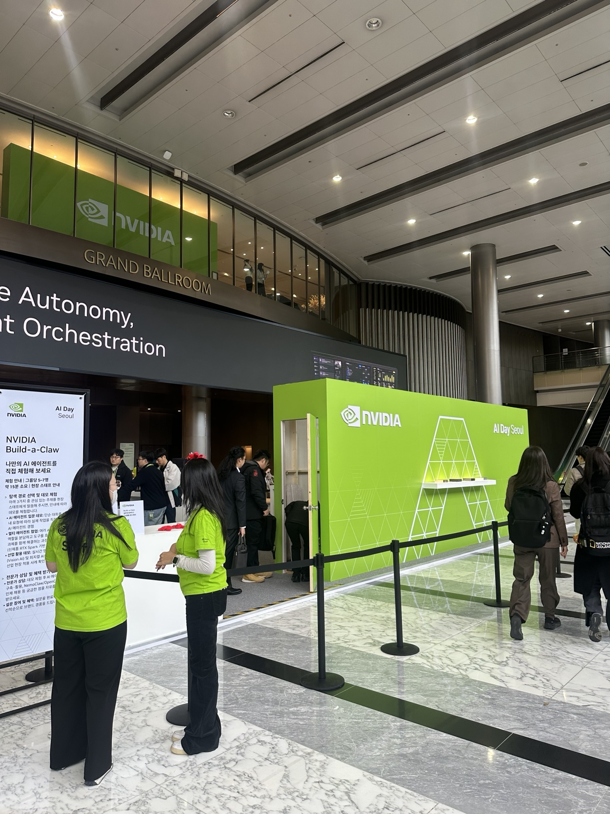</a>
  <a href="/assets/posts/13/library_rescue_game_leaderboard.jpg">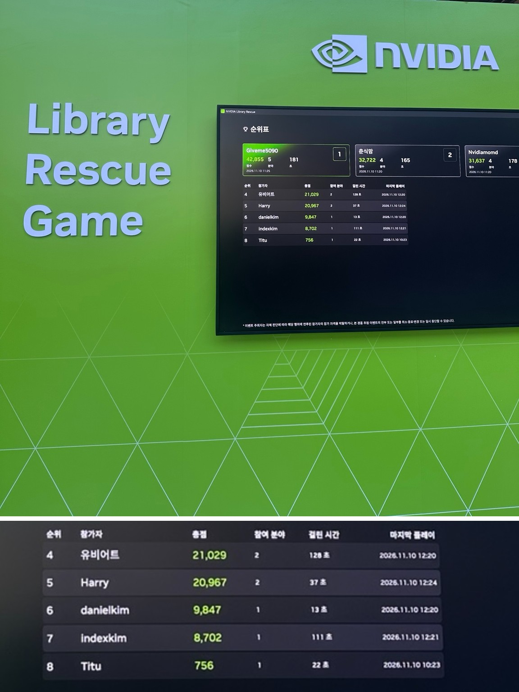</a>
</figure>

오후 워크숍 일정 때문에 추가로 도전하지는 못했습니다.  
(아쉽게도 순위표보다 수료가 우선이었습니다.)

---

## 마무리

이번 NVIDIA AI Day에서는 NCA-GENM 자격증을 취득하고 DLI 워크숍을 수료했습니다.  
평소 접할 기회가 많지 않았던 Physical AI에 새롭게 관심을 갖게 된 점이 가장 크게 남았습니다.

그동안 AI 모델 개발부터 추론 최적화, 서비스 연동 및 운영까지 다양한 업무를 수행해 왔습니다.  
앞으로는 환경 인식과 작업 계획, 실제 행동을 연결하는 시스템도 직접 구현해 보고 싶습니다.

가전제품을 Physical AI의 실행 인프라로 활용하는 구상도 그 연장선에 있습니다.  
기술을 실제 제품으로 구현하려면 로봇의 행동 생성을 넘어,  
가전과의 연동, 물리적 호환성, 장애 대응까지 고려해야 할 것입니다.

2025년 AI EXPO에서는 개발에 참여한 기술을 현장에서 어떻게 보여줄 것인지 고민했다면,  
이번 NVIDIA AI Day는 어떤 기술을 직접 만들어 보고 싶은지 생각해 보는 시간이었습니다.

---

## 참고 자료

- [NVIDIA AI Day Seoul 2026 공식 행사 소개](https://blogs.nvidia.co.kr/blog/ai-day-seoul-2026-preview/)
- [LG전자 - LG CLOiD와 Zero Labor Home](https://www.lg.com/global/newsroom/news/home-appliance-solution/lg-electronics-presents-lg-cloid-home-robot-to-demonstrate-zero-labor-home-at-ces-2026/)
- [NVIDIA OpenShell](https://github.com/NVIDIA/OpenShell)
